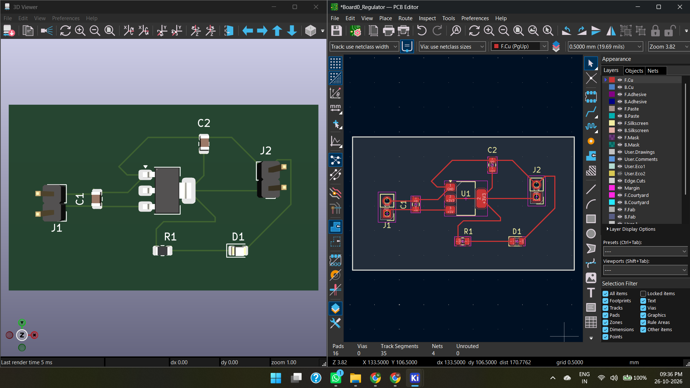

# Board 0: 5V to 3.3V Power Supply PCB

## 📝 Project Overview
This is my first custom Printed Circuit Board (PCB), designed entirely from scratch in **KiCad**. The purpose of this board is to take a standard 5V input and regulate it down to a stable 3.3V output, which will be used to power future microcontroller projects (including a custom STM32 Flight Controller).

## ⚙️ Technical Specifications
*   **Input Voltage:** 5V DC (via 2-pin header)
*   **Output Voltage:** 3.3V DC (via 2-pin header)
*   **Main Component:** LD1117S33TR (SOT-223 package) Low Dropout Regulator
*   **Indicators:** Power-on LED with 150Ω current-limiting resistor
*   **Board Layers:** 2-Layer (Top Copper + Bottom Copper)
*   **Dimensions:** 27mm x 45mm

## 📐 Design Files
*   **Source:** The `/Hardware` folder contains all KiCad source files.
*   **Manufacturing:** The `/Gerbers` folder contains the zipped files ready to be sent to a manufacturer.
*   **Design Check (DRC):** 0 Errors, 0 Unconnected Items.

## 🖼️ Design Preview

## 🛠️ Tools Used
*   **KiCad 10.0** (Schematic Capture & PCB Layout)

## 🚀 Future Plans
This board is step one of a larger project: **Designing a custom Flight Controller**. Next steps include integrating an STM32 Microcontroller, an IMU (Gyroscope/Accelerometer), and USB-C connectivity.
